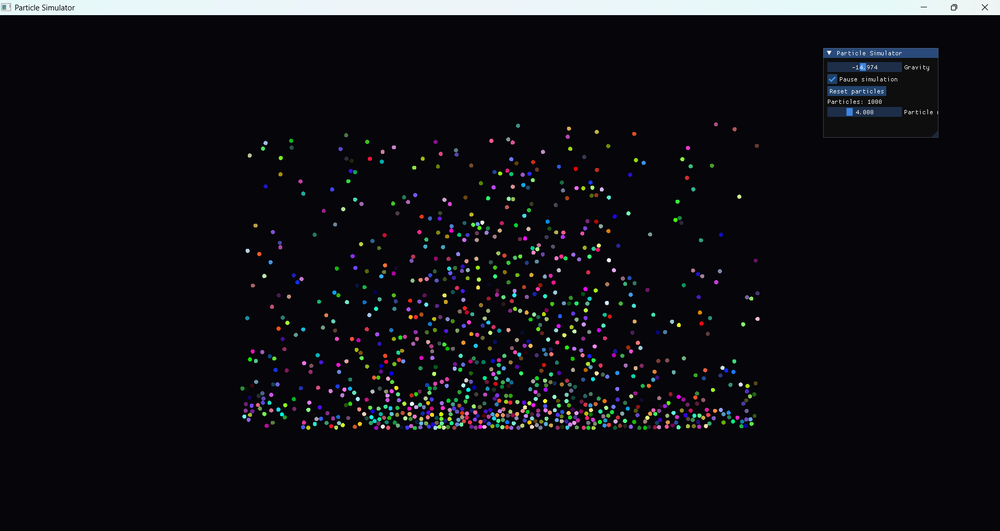

# Particle Simulator

A real-time particle simulation built with **C++**, **OpenGL**, and
**Dear ImGui**.

The project explores particle motion, collision handling, rendering, and
performance-oriented simulation techniques. It is a personal
graphics-programming project and is being developed incrementally.

## Screenshot

## Features

-   Real-time particle rendering with OpenGL
-   Interactive interface built with Dear ImGui
-   2D camera controls
-   GPU particle simulation and collision handling
-   Spatial-grid-based broad-phase collision optimization
-   GPU particle-system and compute-shader experiments in progress

## Built With

-   **C++**
-   **OpenGL** --- rendering
-   **GLFW** --- window and input handling
-   **GLAD** --- OpenGL function loading
-   **Dear ImGui** --- immediate-mode user interface
-   **GLSL** --- vertex, fragment, and compute shaders

## Project Structure

The exact layout may evolve as the project is organized further. The
main application code currently includes:

-   `Camera2D` --- camera movement and zoom
-   `ParticleSystem` --- CPU-side particle simulation
-   `ParticleRenderer` --- particle rendering
-   `GpuParticleSystem` --- GPU simulation experiments
-   `Shaders` --- GLSL shader files

## Getting Started

### Requirements

-   Windows
-   Visual Studio with the **Desktop development with C++** workload
-   A graphics card and driver supporting the OpenGL version used by the
    project

The project currently uses a Visual Studio project setup. Build
instructions may change as the build system is updated.

### Build and Run

1.  Clone or download this repository.
2.  Open `ParticleSimulator.sln` in Visual Studio.
3.  Select the desired configuration, such as **Debug** or **Release**.
4.  Build the solution.
5.  Run the `ParticleSimulator` project.

If the solution or project file names change, follow the files present
in the repository.

## Controls
- **W / A / S / D**	Move the camera
- **Mouse wheel**	Zoom in or out
- **R**	Reset the camera
- **Gravity slider**	Adjust gravity
- **Particle radius slider**	Change particle size
- **Pause simulation**	Pause or resume simulation
- **Reset particles**	Reinitialize particle positions

## Acknowledgements

-   [Dear ImGui](https://github.com/ocornut/imgui)
-   [GLFW](https://www.glfw.org/)
-   [GLAD](https://glad.dav1d.de/)
-   [OpenGL](https://www.opengl.org/)

## License

Check the repository for the applicable license and the licenses of its
third-party dependencies.

